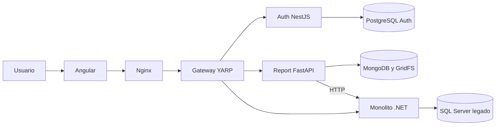
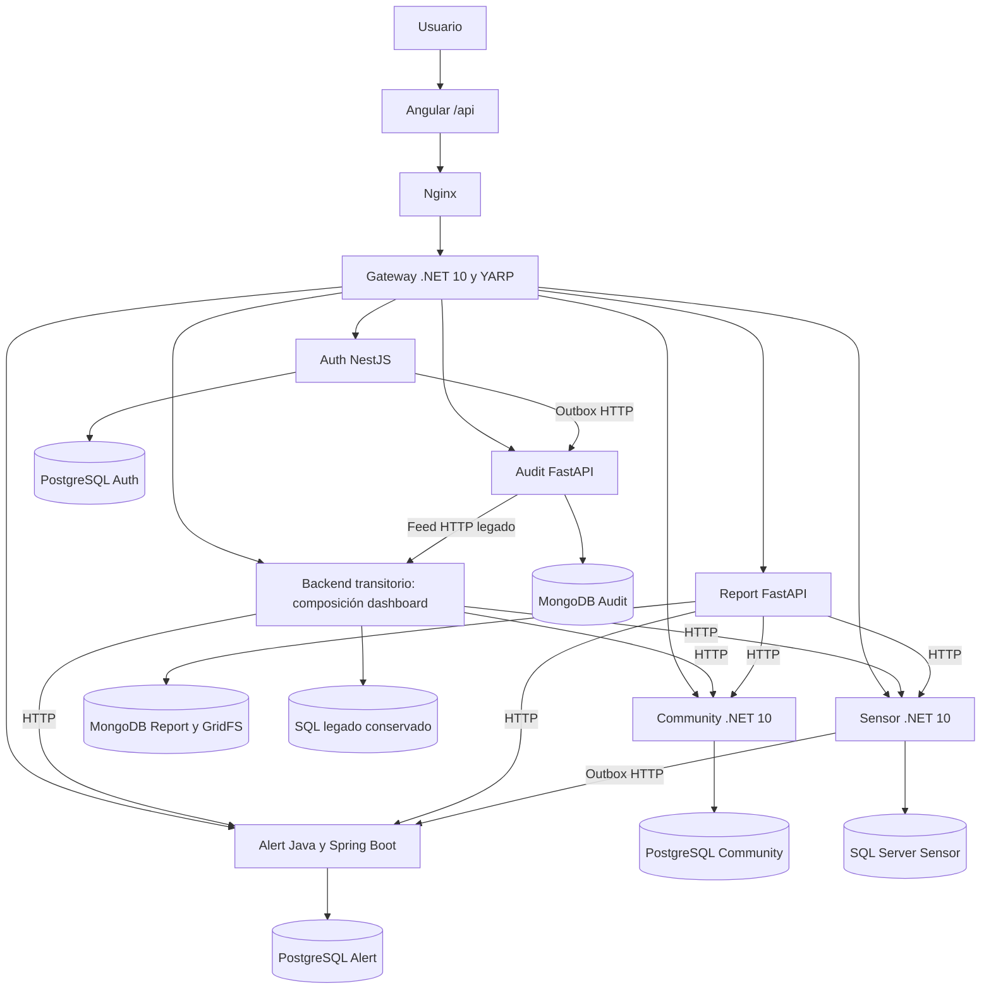

# VIGÍA RURAL — INFORME FINAL DE FASE 3

**Sistema de Alerta Climática: reingeniería progresiva hacia microservicios**

Institución: [INSTITUCIÓN]
Carrera y curso: [CARRERA / CURSO]
Docente: [DOCENTE]
Integrantes: Steve, Astrid y Walter [APELLIDOS / IDENTIFICADORES]
Fecha de entrega: 23 de octubre de 2026, Guatemala
Repositorio: Sistema de Alerta Climática
Rama de integración: `integracion-final-fase3`
Base protegida: `steve-fase3`, commit `5bc6bce`

Este informe describe código, configuración y evidencia del repositorio. Distingue
componentes implementados, validación local y trabajo pendiente; no certifica
producción, equivalencia completa del monolito ni despliegue Kubernetes.

## Índice

1. [Introducción](#1-introducción)
2. [Objetivos](#2-objetivos)
3. [Antecedentes](#3-antecedentes)
4. [Reingeniería del sistema](#4-reingeniería-del-sistema)
5. [Arquitectura de microservicios](#5-arquitectura-de-microservicios)
6. [Frontend Angular](#6-frontend-angular)
7. [API Gateway](#7-api-gateway)
8. [Auth Service](#8-auth-service)
9. [Community Service](#9-community-service)
10. [Sensor Service](#10-sensor-service)
11. [Alert Service](#11-alert-service)
12. [Report Service](#12-report-service)
13. [Audit Service](#13-audit-service)
14. [Persistencia](#14-persistencia)
15. [Seguridad](#15-seguridad)
16. [Docker y despliegue](#16-docker-y-despliegue)
17. [Preparación para Kubernetes/K3s](#17-preparación-para-kubernetesk3s)
18. [Pruebas realizadas](#18-pruebas-realizadas)
19. [Resultados](#19-resultados)
20. [Limitaciones actuales](#20-limitaciones-actuales)
21. [Mejoras futuras](#21-mejoras-futuras)
22. [Conclusiones](#22-conclusiones)
23. [Recomendaciones](#23-recomendaciones)
24. [Referencias técnicas](#24-referencias-técnicas)
25. [Anexos y evidencias](#25-anexos-y-evidencias)

## 1. Introducción

Vigía Rural organiza comunidades, sensores y observaciones climáticas para detectar
condiciones de riesgo y consultar alertas, eventos y reportes. La Fase 3 aborda su
reingeniería mediante una separación progresiva de responsabilidades y persistencia.
El propósito es conservar la aplicación funcional mientras se reemplazan accesos
centralizados por contratos HTTP entre propietarios de datos.

El trabajo conserva Angular, Gateway, Auth y Report desarrollados previamente y
adapta Community y Alert aportados por Astrid. Añade implementaciones mínimas de
Sensor y Audit, sin incorporar el Auth alternativo ni borrar datos de Fase 2.

## 2. Objetivos

### 2.1 General

Evolucionar Vigía Rural hacia servicios con responsabilidad y persistencia propias,
manteniendo una entrada pública estable, autenticación JWT y evidencia verificable.

### 2.2 Específicos

- Conservar la rama estable y trabajar en una rama de integración independiente.
- Adaptar Community y Alert a los contratos, firma JWT e identidad vigente de Auth.
- Separar sensores/lecturas y auditoría mediante SQL Server y MongoDB propios.
- Preparar importaciones insert-only por HTTP, sin conexiones a bases ajenas.
- Enrutar dominios por YARP manteniendo `/api` en Angular y precedencias anidadas.
- Comprobar servicios con bases reales y documentar resultados y límites.
- Mantener manuales de usuario/técnico y preparar la transición a VPS/K3s.

## 3. Antecedentes

La Fase 2 implementó una aplicación Angular y un backend .NET con SQL Server que
contenía identidad, comunidades, sensores, lecturas, reglas, alertas, eventos,
auditoría y dashboard. Esa organización facilitaba transacciones y relaciones
locales, pero vinculaba despliegue, recursos y evolución de todos los dominios.

Los incrementos iniciales de Fase 3 extrajeron Gateway, Auth y Report. Auth conserva
usuarios y contraseñas compatibles con ASP.NET Identity en PostgreSQL. Report
compone datos por HTTP y almacena metadatos/PDF en MongoDB/GridFS. El cierre amplía
esa separación sin reemplazar las implementaciones ya verificadas.

## 4. Reingeniería del sistema

Se creó `integracion-final-fase3` desde una rama limpia `steve-fase3`. Se incorporaron
selectivamente `a37081d` (Community) y `3d73a24` (Alert). El commit `2adac5e` de Auth
no fue incorporado: habría sustituido una implementación con credenciales, JWT,
outbox y contratos ya integrados. Los conflictos de exclusiones Git se resolvieron
conservando reglas de Steve y añadiendo la exclusión de artefactos Maven.

La auditoría detectó incompatibilidades concretas: JWT con clave directa en vez de
SHA-256, permisos distintos, paginación `items/page` frente a `data/pageIndex`,
campos geográficos obligatorios incompatibles con históricos y ausencia de APIs de
eventos. Se adaptaron esos puntos y se agregaron health, Dockerfiles y pruebas.

La migración lee contratos HTTP del origen detenido para escrituras e inserta en
destinos conservando UUID. No actualiza registros ya existentes ni elimina el
origen. Las rutas siguen en el monolito por defecto hasta completar importación y
conciliación; un archivo separado activa el corte de validación.

## 5. Arquitectura de microservicios

### Arquitectura estable anterior al cierre



### Integración alcanzada y activada en validación



Auth, Community, Sensor, Alert, Report y Audit son procesos separados. El backend
permanece transitoriamente para composición HTTP del dashboard y exportación de
auditoría histórica; su SQL se conserva como respaldo de la transición. No se
considera completada la eliminación del monolito ni una migración de producción.

La arquitectura objetivo elimina esos últimos adaptadores una vez acreditada la
paridad y adoptada una estrategia de consistencia, operación y recuperación.

## 6. Frontend Angular

Angular conserva páginas, modelos, guards, interceptores y `API_BASE_URL=/api`.
No se agregan direcciones de microservicios ni secretos al navegador. La navegación
cubre login, resumen, comunidades, sensores, lecturas, alertas, reglas, eventos,
usuarios, bitácora y reportes según los permisos existentes.

Los formularios conservan su estructura; la compatibilidad se resuelve en las APIs.
El historial de reportes cancela consultas anteriores para evitar respuestas fuera
de orden; la descarga usa Blob y un nombre saneado de Content-Disposition. La
inspección interactiva y las capturas siguen pendientes; las pruebas Headless no
sustituyen esa inspección.

## 7. API Gateway

ASP.NET Core 10/YARP conserva el enrutamiento, CORS por origen, validación JWT
preliminar, correlación UUID, logs acotados, errores de transporte y filtrado de
cabeceras de identidad/infrastructura no confiables. Las políticas efectivas de
negocio se aplican en cada propietario con identidad vigente de Auth.

| Ruta pública | Destino después del corte |
|---|---|
| `/api/auth/*`, `/api/users/*` | Auth |
| `/api/communities/*` | Community |
| `/api/communities/{id}/sensors/*` | Sensor, con prioridad -20 |
| `/api/sensors/*`, `/api/sensor-readings/*` | Sensor |
| `/api/communities/{id}/alerts/*` | Alert, con prioridad -20 |
| `/api/alerts/*`, `/api/alert-rules/*`, `/api/events/*` | Alert |
| `/api/reports/*` | Report |
| `/api/audit-actions/*` | Audit |
| `/api/dashboard` | Backend transitorio, compuesto por APIs |
| Resto `/api/*` | Fallback legado, prioridad 100 |

La nueva readiness comprueba únicamente los clusters adicionales activados; un
servicio todavía en preparación no reduce por sí solo disponibilidad del modo
legado. Se conservan liveness independiente y errores 502/503/504 controlados.

## 8. Auth Service

Auth continúa siendo el NestJS/TypeScript de Steve sobre Node 24 y PostgreSQL.
Preserva hashes PasswordHasher Identity V2/V3 mediante PBKDF2 y validación constante.
JWT usa HS256 con `SHA256(UTF8(JWT_KEY))`, issuer/audience compartidos y expiración.
Los roles Administrator, Operator y ConsultationUser determinan permisos vigentes.

Cada servicio protegido consulta `/internal/identity/current` con bearer y clave
interna. Un JWT anterior no conserva permisos retirados por cambio de rol o estado.
La outbox de Auth entrega auditoría con ID estable al destino configurado. Logout
limpia sesión y registra evento, pero no revoca access tokens ya emitidos.

## 9. Community Service

Se reutiliza el servicio C#/.NET 10, EF Core y PostgreSQL de Astrid. Administra
nombre, ubicación, municipio, departamento, país, coordenadas, descripción y
estado. Conserva CRUD, filtros y el doble formato de listado: array sin query y
paginado con query. La respuesta paginada se adaptó al contrato Angular/Report.

Las coordenadas y datos administrativos históricos pueden ser nulos; una migración
aditiva reduce la restricción sin inventar valores. La importación HTTP opt-in
conserva UUID y omite registros ya existentes. Los conteos y dependencias externas
se consultan a Sensor/Alert por HTTP, sin acceder a sus bases. Escrituras requieren
Operator/Administrator con identidad Auth vigente. La ingesta no destructiva no
sustituye una conciliación de cambios que existan en ambos destinos.

## 10. Sensor Service

Se implementó un servicio .NET 10/EF Core con SQL Server propio: sensores, tipo,
estado, comunidad por UUID, ubicación, unidad, instalación y observaciones. Expone
altas/edición/estado, lectura manual, última lectura e historial paginado; los
contratos incluyen `sensorStatusAtMeasurement` y fechas originales.

La última lectura por lote se selecciona antes de paginar, reutilizando el patrón
SQL APPLY de Fase 2. La simulación reutiliza su generador, queda desactivada por
defecto y debe ejecutarse en una sola instancia por dataset. Lectura y outbox se
guardan juntas; un worker entrega el evento por HTTP a Alert sin guardar JWT.

La versión es mínima: no se declara paridad completa de reinicios de monitoreo,
edición avanzada y todos los casos de concurrencia administrativa del monolito.
La migración interna acepta lotes acotados e inserta IDs faltantes en su propia base.

## 11. Alert Service

Se conserva Java 21, Spring Boot, JPA y PostgreSQL del aporte de Astrid. El servicio
posee reglas, umbrales, condiciones históricas, alertas y eventos. Se adaptaron firma
JWT, permisos vigentes, consultas públicas, errores y contratos enriquecidos; se
añadieron historial, detalle y estadísticas de eventos.

Los fenómenos usan los nombres contractuales Flood, Drought, Storm, Frost y
Wildfire (Incendio Forestal), y niveles Green, Yellow, Orange y Red. Se mantienen
snapshots de condición para que editar una regla no reescriba la evidencia anterior.
El evento conserva el mayor nivel histórico. Las acciones manuales requieren
OperateSystem; los eventos requieren ConsultEvents.

La ingesta interna autentica al emisor, serializa evaluación por sensor/variable y
deduplica UUID de lectura en PostgreSQL. La validación real detectó y corrigió una
asociación JPA perdida al ignorar la entidad administrada devuelta por save().
Se corrigió también el uso de códigos explícitos y conflictos de reglas. Las pruebas
del monolito sirven como especificación, pero no se afirma haber portado toda su suite.

## 12. Report Service

El motor FastAPI/Python, Jinja2 y WeasyPrint de Steve se conserva. Solo cambian
destinos de clientes: Community, Sensor y Alert/Event. MongoDB guarda metadatos y
GridFS almacena PDFs; cada solicitante consulta y descarga documentos propios.

Tipos: Comunidades, Sensores, Lecturas, Alertas, Historial de eventos, Estado de
sensores, Estadísticas climáticas y Resumen ejecutivo. Los ausentes se presentan
como N/D; las estadísticas separan variable/unidad y no inventan lluvia acumulada.
La generación conserva límites de filas, bytes y tiempo, y la descarga no vuelve
a consultar las fuentes de datos originales.

## 13. Audit Service

Audit utiliza FastAPI y MongoDB independientes. Registra acción, identidad,
fecha/hora, recurso, resultado y correlación cuando existe. Un evento conserva su
UUID como clave idempotente; un reenvío de outbox no duplica el registro. La consulta
filtra usuario, acción, entidad y fechas, y pagina bajo autorización Administrator.

La outbox Auth se dirige a Audit tras el corte. Un feed HTTP autenticado del
monolito conserva las acciones históricas y las escrituras legacy todavía atómicas
en SQL. Audit guarda su checkpoint y consulta ese feed sin credenciales SQL. La
correlación histórica no almacenada se mantiene nula. El payload proyectado excluye
hashes, passwords, bearer y cuerpos arbitrarios.

Community y Sensor guardan auditoría junto a sus mutaciones en outboxes propias;
Alert encola reglas, atención/cierre y evaluación automática dentro de PostgreSQL.
Los workers entregan por HTTP e identificador estable. Queda pendiente certificar
todos los rechazos y detalles de transiciones; no se afirma auditoría global completa.

## 14. Persistencia

| Motor | Propietarios y uso | Característica de esta implementación |
|---|---|---|
| PostgreSQL | Auth, Community, Alert, cada uno en instancia/volumen separado | Relaciones e índices locales; migraciones propias y transacciones |
| SQL Server | Sensor; una instancia legacy adicional conservada | Lecturas indexadas, historial, outbox y selección eficiente por sensor |
| MongoDB | Report y Audit en instancias/volúmenes separados | Documentos con filtros/metadata; GridFS para bytes PDF |

NoSQL no significa ausencia de validación: FastAPI valida entrada y los servicios
crean índices. Tampoco elimina la necesidad de backups, retención o consistencia.
No existen joins SQL entre bases de servicios. Las relaciones externas usan UUID,
contratos HTTP y snapshots/proyecciones explícitas.

## 15. Seguridad

El navegador nunca envía credenciales de bases. Gateway filtra headers de identidad
y servicio del cliente; cada propietario valida JWT y la identidad Auth vigente.
401 indica sesión inválida o inactiva; 403 indica permiso insuficiente. Report usa
404 para documentos ajenos. Las claves internas protegen rutas no expuestas por
Nginx/Gateway y no sustituyen autenticación de usuario en endpoints públicos.

Los secretos se cargan desde archivos locales ignorados y variables; los ejemplos
solo contienen placeholders. Producción requiere TLS externo y rotación de claves.
No se implementa OAuth/OIDC: Spring utiliza su biblioteca de validación JWT, sin
introducir proveedor de identidad ni flujos OAuth. Revisión de dependencias,
hardening y pruebas de penetración completas siguen pendientes.

## 16. Docker y despliegue

`docker-compose.phase3.yml` conserva el modo estable. El overlay
`docker-compose.final.yml` añade Community/PostgreSQL, Sensor/SQL Server,
Alert/PostgreSQL y Audit/MongoDB: 16 contenedores incluyendo el backend/SQL transitorio.
No se publican bases ni APIs internas; solo Nginx enlaza un puerto host loopback.
Las redes de persistencia son internas y los volúmenes están separados por propietario.

El corte se activa después de importar y conciliar mediante
`final-cutover.env.example`. Se preparó un overlay de producción adicional con
límites y edición SQL configurable. Configuración válida y arranque local no
equivalen a despliegue público certificado. Comandos: [despliegue](despliegue.md).

## 17. Preparación para Kubernetes/K3s

Los destinos se configuran por DNS/variables y los procesos exponen vida/readiness.
Las bases requieren PVC y políticas de backup; JWT, claves internas y passwords
deben trasladarse a Secrets y la configuración no secreta a ConfigMaps.

Se necesitan Deployments/Services y probes separadas, terminación ordenada y
dimensionamiento. La simulación debe permanecer en una sola instancia. La outbox
Sensor requiere coordinación/lease para escalado; la idempotencia del receptor no
sustituye un control de múltiples simuladores. No se entregó ni probó un cluster K3s.

## 18. Pruebas realizadas

Los resultados exactos de esta ejecución, fechas y límites se registran en
[pruebas](pruebas.md). Incluyen builds .NET/Node/Angular, pytest con Mongo/PDF,
pruebas JUnit de dominio, persistencia JPA con PostgreSQL real, validación de
Community/Sensor y pruebas Audit con Mongo real. No se atribuyen a este cierre
pruebas interactivas, carga sostenida ni producción no ejecutadas.

La importación comprobó 38 sensores, 69,120 lecturas, 13 reglas, 14 alertas y
14 eventos del snapshot histórico, conservando el origen. Los datos nuevos de E2E
permanecen en las bases aisladas de validación; estos números no representan el
conteo posterior a todas las pruebas de escritura.

## 19. Resultados

Se dispone de seis servicios y sus bases propias, manteniendo Angular y el motor
de reportes. La configuración permite un corte reversible de rutas después de la
conciliación. Dashboard conserva su URL pública y compone datos de propietarios
por HTTP; la persistencia legacy permanece como respaldo de transición y feed de
auditoría. Las referencias de código y evidencia permiten reproducir el trabajo.

La integración se mide por flujos y registros reales, no por el número de carpetas.
Las secciones de evidencia identifican qué fue ejecutado y qué permanece pendiente.

## 20. Limitaciones actuales

- Sensor es una versión mínima; requiere completar equivalencia administrativa y
  concurrencia del contrato completo antes de un corte productivo definitivo.
- No se trasladó automáticamente toda la especificación de pruebas de reglas,
  evaluación, ciclo de vida y eventos del monolito a Java.
- Alert aún enriquece consultas por HTTP y algunas consultas filtran en memoria;
  deben optimizarse para grandes historiales y evitar N+1.
- Algunos nombres de responsables no se conservan como snapshot y se devuelven
  nulos; no se inventan identidades históricas.
- La auditoría de operaciones principales usa outboxes; falta certificar todos
  los rechazos, metadatos y transiciones automáticas.
- El importador inserta faltantes; no reconcilia ediciones paralelas ni borra.
  Se debe detener escritura y simulación legacy durante el corte.
- Report continúa síncrono, con una generación por proceso y límites explícitos.
  Un crash entre GridFS y metadatos puede requerir reconciliar archivos huérfanos.
- Producción, restauración integral, carga sostenida, OAuth/OIDC y K3s no están certificados.
- Las capturas y la inspección visual interactiva deben completarse manualmente.

## 21. Mejoras futuras

Incorporar OAuth2/OIDC en Fase 4; desplegar K3s con gestión de secretos y PVC;
adoptar mensajería/eventos o leases para outboxes; implementar generación de
reportes asíncrona; ampliar observabilidad con métricas/trazas; completar contratos
y auditoría de todos los dominios; automatizar conciliación y recuperación.

## 22. Conclusiones

La reingeniería conserva una entrada pública estable y separa persistencia por
dominio. La adaptación selectiva evita reemplazar Auth/Report y permite reutilizar
trabajo de distintos integrantes. Los errores de JWT, paginación y persistencia
encontrados muestran por qué compilar un servicio no basta para declararlo integrado.

El resultado constituye una integración local verificable y una base para continuar
la migración, con límites explícitos. No implica que desaparezcan automáticamente
dependencias, consistencia distribuida o responsabilidades operativas.

## 23. Recomendaciones

Conservar la rama estable y respaldos del origen; revisar diferencias antes de
publicar la rama de integración. Mantener el corte opt-in hasta ejecutar los
criterios de aceptación del equipo. Completar paridad, cobertura completa de
auditoría y revisión de dependencias antes de producción. Definir retención,
backups, RPO/RTO y responsables; repetir flujos después de cada cambio de destinos.

## 24. Referencias técnicas

Las versiones instaladas se toman de los archivos del repositorio, no de la versión
más reciente de documentación externa.

- [Gateway y configuración YARP](../../gateway/src/ClimateAlert.Gateway/Program.cs).
- [Middleware YARP, Microsoft](https://learn.microsoft.com/en-us/aspnet/core/fundamentals/servers/yarp/middleware?view=aspnetcore-10.0).
- [PasswordHasher ASP.NET Identity](https://source.dot.net/Microsoft.Extensions.Identity.Core/PasswordHasher.cs.html).
- [Dependencias Auth](../../services/auth-service/package.json).
- [Community y EF Core](../../services/community-service/CommunityService.csproj).
- [Sensor y SQL Server](../../services/sensor-service/SensorService.csproj).
- [Alert y Spring Boot](../../services/alert-service/pom.xml).
- [Dependencias Report fijadas](../../services/report-service/requirements.lock).
- [Instalación WeasyPrint](https://doc.courtbouillon.org/weasyprint/stable/first_steps.html).
- [Audit FastAPI/Mongo](../../services/audit-service/app.py).

## 25. Anexos y evidencias

| Marcador | Pantalla/acción | Contenido y función demostrada |
|---|---|---|
| [CAPTURA PENDIENTE: Inicio de sesión] | `/login` | Campos y botón sin credenciales; entrada al sistema |
| [CAPTURA PENDIENTE: Dashboard integrado] | Resumen, comunidad con datos | Indicadores, sensores y actividad desde propietarios |
| [CAPTURA PENDIENTE: Comunidades] | Comunidades, filtro activo | Datos administrativos y paginación |
| [CAPTURA PENDIENTE: Sensores y lectura] | Detalle de sensor de prueba | Estado, unidad, última lectura e historial |
| [CAPTURA PENDIENTE: Reglas y umbrales] | Reglas, cuenta operadora | Condición, fenómeno, nivel y vigencia |
| [CAPTURA PENDIENTE: Ciclo de alerta] | Alerta de prueba antes/después de atender/cerrar | Estados y evidencia de lectura |
| [CAPTURA PENDIENTE: Evento] | Detalle de evento asociado | Alertas/sensores, nivel histórico y cierre |
| [CAPTURA PENDIENTE: Auditoría] | Bitácora, Administrator | Filtros, usuario, acción, recurso y fecha |
| [CAPTURA PENDIENTE: Reportes] | Formulario y Mis reportes | Filtros, generación, estado y descarga |
| [CAPTURA PENDIENTE: PDF] | Documento descargado | Título, usuario, UTC, tablas y número de página |
| [CAPTURA PENDIENTE: Docker saludable] | `docker compose ps` | Servicios/bases y estado; ocultar secretos |

Evidencia local: `tmp/final-migration.log`, `tmp/final-e2e-results.json`,
`tmp/alert-real-postgres.log`, logs de compilación/suites y `tmp/report-evidence/`.
No se adjuntan archivos de credenciales ni exportaciones sensibles al informe.

### Revisión y preparación de entrega

```powershell
git switch integracion-final-fase3
git status --short
git log --oneline steve-fase3..HEAD
git diff --stat steve-fase3..HEAD
git diff --check steve-fase3..HEAD
```

Después de revisar y aceptar la integración, Steve puede publicar explícitamente:

```powershell
git push -u origin integracion-final-fase3
```

Para preparar únicamente la documentación oficial (sin `.env`, evidencia privada
ni guía personal de estudio), completar portada y capturas y ejecutar:

```powershell
Compress-Archive -LiteralPath docs/fase3 -DestinationPath entrega-fase3-documentacion.zip
```

La guía personal permanece en `estudio/guia-defensa-steve.md`, fuera del entregable
oficial. No adjuntar `tmp/`, credenciales, snapshots con datos personales ni
volúmenes de bases. El repositorio se entrega mediante la rama revisada; el ZIP
anterior contiene solo documentación y no sustituye el código fuente.
